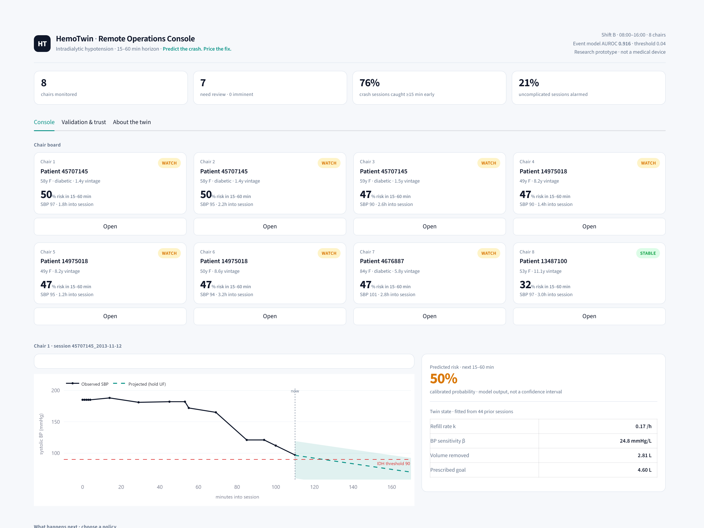

# HemoTwin

**Predict the crash. Price the fix.**


A remote-operations digital twin for haemodialysis that predicts intradialytic hypotension (IDH) 15–60 minutes ahead, then simulates holding, tapering, or stopping ultrafiltration and shows the blood-pressure gain against the fluid left behind.




*The console on a real held-out session: 50% risk, a 25% taper still projects a nadir of 77 mmHg, and stopping UF clears 90 at a cost of 1.79 L.*

---

## Team details & college

| Field | Detail |
|---|---|
| **Team name** | `Ozz` |
| **College / incubator** | `National Institute of Technology, Silchar` |
| **Team leader** | `Ayandeep Bharadwaj - ML + Twin` · `9101582922` · `ayandeep666@gmail.com` |
| **Member 2** | `Prasenjeet Tiwari — PPT + Video + Web` |
| **City / state** | `Silchar, Assam` |
| **Submission date** | `24 October 2026` |


**Positioning statement.** HemoTwin is a research-stage clinical decision-support prototype for haemodialysis units. It maintains a per-patient volume and refill state, predicts intradialytic hypotension 15–60 minutes ahead, and simulates the blood-pressure and fluid consequences of holding, tapering, or stopping ultrafiltration. It is not a medical device and does not issue prescriptions.

---

## Youtube Video - https://youtu.be/ezq2eWIAmj8


## Problem statement & healthcare use case

A four-hour haemodialysis session is a tightrope. The machine must remove the fluid the kidneys cannot, fast enough to reach dry weight, slowly enough that blood pressure does not collapse. Intradialytic hypotension is the failure mode: systolic blood pressure drops below 90 mmHg, the patient cramps, vomits, or loses consciousness, and the session ends with saline, a UF pause, and fluid left behind.

The clinical problem is not a lack of monitors. It is a lack of **lead time** and a lack of **consequence modelling**:

- Blood pressure is measured by cuff roughly every 30 minutes. The crash is visible only after it has started.
- The nurse's real decision is a trade-off: taper ultrafiltration now and leave fluid behind, or hold and risk the crash. Nothing on the machine prices either option.
- One nurse often covers several chairs. Attention, not information, is the scarce resource.

**Why India, and why this condition:**

| Fact | Value | Source |
|---|---|---|
| Dialysis centres under the Pradhan Mantri National Dialysis Programme (PMNDP) | **1,700+**, many in district hospitals without on-site nephrology | programme figures |
| Diabetic patients in our dialysis cohort | **34.5%** (370 / 1,072) | HEMOBP |
| Sessions per patient per year | **156** (3 per week) | arithmetic |
| Median dialysis vintage in cohort | **9.6 years** (IQR 6.5–14.5) | HEMOBP |
| Estimated dialysis sessions per year in India | ~34 million (estimate, not a measurement) | derived |

Where there is no on-site nephrologist, remote supervision is the only scalable model: a central clinician covers many chairs and needs exception-based triage, not another raw feed. HemoTwin is built for that console. The 34.5% diabetic share is not incidental: diabetic kidney disease is the terminal stage of India's type 2 diabetes epidemic, so this is the downstream ward of the country's largest chronic-disease problem.

**Target user:** the dialysis nurse at the chair, and the remote nephrologist supervising several units. **Target decision:** when to taper ultrafiltration, and what that taper costs in fluid not removed.

---

## What is a digital twin here

A classifier answers *"will this patient crash?"* A twin answers *"what happens to this patient under policy A instead of policy B?"* HemoTwin has three layers, and only the first one is a predictor.

### Layer 1 — Event model (the alarm, done properly)

A LightGBM model scores every blood-pressure reading. The label is a **first IDH event** with nadir SBP < 90 mmHg and onset inside the window `(t+15, t+60]` minutes. Patient-disjoint split. 40 machine-derived features, causal history only. Test AUROC **0.916**. This layer is necessary and not sufficient; it is the engine, not the product.

### Layer 2 — Physiological twin (the state)

A two-parameter volume and refill model carries a per-session state forward at every reading:

```
dV/dt  = -UF(t) + k_refill * (V_target - V(t))
SBP(t) = SBP0 + beta_bp * (V(t) - V0) - gamma * elapsed(t)
```

`k_refill` (plasma refill rate) and `beta_bp` (systolic sensitivity to volume) are estimated with a population prior and updated from the patient's own prior sessions. The implementation solves the same equation in deficit form, `dD/dt = UF - k_refill*D` with `D = V_target - V`, which is numerically better behaved. **`gamma` is 0 in the shipped fit**: at a roughly 30-minute cuff cadence a free time-trend term is collinear with `beta_bp`, so the twin keeps only the two parameters it can identify.

Every parameter has a name a nephrologist recognises, which is the point: the twin is auditable. The volume state is checked against **measured** weight loss from the session weight record, not against itself.

### Layer 3 — Counterfactual policy simulation (the product)

The twin rolls forward under three policies the nurse actually faces:

| Policy | What the twin predicts | What it costs |
|---|---|---|
| **A. Hold current UF** | nadir SBP over the next hour, time-to-nadir | crash risk and rescue events |
| **B. Taper UF by 25%** | nadir SBP with an empirical interval | litres not removed by session end |
| **C. Stop UF and give 250 mL** | fastest recovery | largest fluid deficit |

Each nadir carries a **90% band built from held-out residuals** (5th to 95th percentile of the residual distribution), so the nurse sees a range, not a false-precision number.

**Why this is not another alarm.** The event model is the commodity layer; published predictors already exist. The twin layer is the claim: a state that persists and updates, a forward model whose parameters are physiological, and a counterfactual that reports the *price* of the safer option. A sensitivity slider over a classifier cannot do this, because perturbing a feature is not a policy and does not produce a trajectory. HemoTwin simulates the next hour under each policy and shows the frontier between BP gained and fluid forgone.

---

## Architecture

Five stages, left to right. Each column is a module in this repository; the twin column is the product.

```
  DATA                FEATURES         MODELS           TWIN                DASHBOARD
  machine telemetry   quality filters  LightGBM         volume state        chair board
  BP, UF, dialysate   label builder    isotonic cal.    k_refill, beta_bp   session view
  HEMOBP (Taiwan)     40 features      AUROC 0.916      counterfactual      twin state
  1,070 patients      patient split    rule baselines   hold, taper, stop   what-if frontier
  Mendeley (Spain)    70 / 15 / 15     8.4x lift        90% band            trust panel
  97,640 sessions     causal shift(1)  calibr. held-out volume check        8 chairs, ranked
```

Full detail, including a Mermaid version and the artifact table: [`docs/ARCHITECTURE.md`](docs/ARCHITECTURE.md). Printable diagram: [`docs/architecture.svg`](docs/architecture.svg).

---

## Technical stack & model details

### Stack

| Layer | Choice |
|---|---|
| Language | Python 3.11+ |
| Data handling | pandas, numpy |
| Model | LightGBM (gradient-boosted trees) |
| Calibration and metrics | scikit-learn, scipy |
| Twin and empirical uncertainty bands | numpy, scipy |
| Dashboard | Streamlit + Plotly |
| Persistence | JSON, native LightGBM model file |
| Runtime | CPU only, no GPU |

### Model specification

| Item | Detail |
|---|---|
| **Data** | HEMOBP (Taiwan): 1,070 patients, 205,482 sessions after quality filters, 4,190,926 telemetry rows, 2,342,586 BP measurement events. External session-level check on Mendeley Dialysis Database (Spain): 758 patients, 97,640 sessions. |
| **Features** | 40, all machine-derived: current SBP, DBP and MAP; BP slopes and minima over 15, 30, 60 and 120 minute windows; drop from session maximum; number of readings so far; UF rate, cumulative UF, UF intensity in mL/kg/h, fraction of the prescription completed and gap to the required rate; dialysate temperature, conductivity and blood flow; elapsed fraction and minutes to session end; dry and pre-session weight; prior-session IDH rate, prior nadir and prior first SBP (strictly earlier sessions); plus static age, sex, diabetes status and dialysis vintage. |
| **Label** | 1 if a **first** IDH event occurs with nadir SBP < 90 mmHg and onset in `(t+15, t+60]` minutes. Anchors within 15 minutes of onset are dropped, not labelled 0. Anchors with no BP reading in the window are dropped, never imputed as negatives. |
| **Split** | Patient-disjoint 70 / 15 / 15. No patient appears in two splits; the constraint is asserted in code. |
| **Model** | LightGBM, 31 leaves, learning rate 0.02, early stopping on validation AUPRC, `scale_pos_weight` capped at 25. |
| **Calibration** | Isotonic regression fitted on one half of the validation split, reported on the other half. |
| **Twin** | `dV/dt = -UF + k_refill*(V_target - V)`, `SBP = SBP0 + beta_bp*(V - V0) - gamma*t`. Two fitted parameters per patient (`k_refill`, `beta_bp`), population prior plus patient history. `gamma` is fixed at 0 in v1 because it is not identifiable at a 30-minute cuff cadence. |
| **Uncertainty** | 90% empirical band on predicted nadir, from the 5th-95th percentile of held-out residuals. |
| **Serving** | Per blood-pressure reading, under 50 ms on CPU. No GPU, no network call. |

Prediction anchors: 1,268,990. Positive anchors: 32,221 (2.54%). Test split: 169,854 anchors, 4,764 positives (2.80%).

---

## Results

Event-model metrics below are from the patient-disjoint HEMOBP test split; cohort and telemetry counts describe the full filtered cohort. Every number is reproduced from `docs/FACTS.md`.

| Metric | Value |
|---|---|
| Cohort | HEMOBP, Taiwan, **1,070 patients** |
| Sessions (after quality filters) | **205,482** |
| Telemetry rows | **4,190,926** |
| BP measurement events | **2,342,586** |
| Prediction anchors (cohort) | **1,268,990** |
| Positive anchors (cohort) | **32,221 (2.54%)** |
| Features | **40** |
| Test anchors / positives | **169,854 / 4,764 (2.80%)** |
| AUROC | **0.916** (95% CI 0.897–0.932, patient-clustered bootstrap) |
| AUPRC | **0.236 = 8.4× prevalence** |
| Sensitivity @ 90% specificity | **0.697** |
| Rule baseline R1 ("alarm when SBP is low") AUROC | **0.787** |
| Rule baseline R2 ("extrapolate BP slope") AUROC | **0.738** |
| Frozen threshold | **0.0410** (validation, 85% sensitivity target) |
| Test sensitivity at threshold | **0.862** |
| Event-level detection | **1,783 / 2,073 evaluable = 86.0%**; **1,783 / 2,354 = 75.7% of all IDH sessions** |
| False-alarm session rate | **20.6%** |
| Sessions with no warnable window | **281** |
| Session-level PPV | **28.1%** (2,016 of 7,182 flagged sessions truly crashed) |
| Brier score | **0.0235** |
| ECE, patient-disjoint test | **0.0017** (validation-holdout ECE 0.0008, row split) |

**Both detection denominators are the result.** 86.0% counts only sessions that had at least one anchor inside the 15–60 minute warning window. 75.7% counts every IDH session, including the 281 where the cuff cadence left no usable anchor. The second number is the honest one and the one we lead with in clinical conversation.

**AUPRC is 0.236, a lift of 8.4× over the 2.80% test prevalence.** At low prevalence AUROC flatters every model, so we report the lift, the sensitivity at fixed specificity, and the comparison against two zero-training rules. The gain over R1 at 90% specificity is the comparison that matters clinically. Our AUPRC is higher than the best published external AUPRC for this task (Kim et al. 2022, 0.106), but the cohort, label and horizon differ; we do not treat that as a like-for-like win.

### Twin validation

The twin is checked against something outside itself: the measured pre/post weight difference recorded for each session.

| Check | Value |
|---|---|
| Sessions with measured pre/post weight | **16,591** |
| Modelled minus measured UF, median | **+0.07 L** |
| Modelled minus measured UF, MAE | **0.40 L** |
| Sessions within 0.5 L of measured UF | **75.0%** |
| Correlation, modelled vs measured UF | **0.768** |
| Held-out nadir error (hold policy), MAE | **13.6 mmHg** |
| Held-out nadir residual, 5th–95th percentile | **−36.6 to +22.6 mmHg** |

The residual band is wide, and the dashboard plots it. A two-parameter model fitted to a 30-minute cuff cadence cannot promise a point estimate, and pretending otherwise would be the dishonest move.

**On the published comparator.** We do not claim to beat Zhang et al. (NDT 2023) on AUROC; our 15–60 min horizon is narrower than their 15–75 min horizon, and a nearer horizon is an easier task. What we claim instead is a different artifact: a UF-policy twin, a volume state checked against measured weight loss, and a patient-disjoint validation with event-level and alarm-burden reporting.

### External cohort (different task, reported separately)

| Metric | Mendeley Dialysis Database, Spain |
|---|---|
| Patients | 758 |
| Sessions | 97,640 |
| Hypotension prevalence | 25.5% (24,912 / 97,640) |
| Label | `D_Hipotension` = `SI` / `NO` |
| Granularity | session-level only (one pre and one post BP, no time series) |
| Licence | CC BY 4.0 |

Mendeley cannot validate a 15–60 minute event model because it has no intra-session time series. It supports a session-level task ("will this session be labelled hypotensive?") only.

**We ran that transport check, and it failed.**

| Model | Cohort | n | AUROC |
|---|---|---|---|
| Six-feature session model | HEMOBP, held-out patients | 50,044 | **0.720** |
| Same model, no retraining | Mendeley, Spain | 97,633 | **0.474** |

The cause is label semantics, not a silent bug. HEMOBP labels a nadir below 90 mmHg. The Spanish registry records clinician-defined **symptomatic** hypotension, which behaves more like a fall from baseline. The direction of pre-dialysis SBP reverses between the cohorts (AUROC 0.325 versus 0.611). We report the failure in full in [`docs/EXTERNAL_VALIDATION.md`](docs/EXTERNAL_VALIDATION.md), and we claim **no external validity**. Deployment means retraining on the partner unit's label, not transplanting probabilities.

Combined data scale: **303,122 sessions** across **two countries** (205,482 + 97,640), **1,828 patients**. That is the data scale, not an external-validation claim.

---

## The insight that motivates the twin

We measured what staff actually do, on 32,565 real sessions:

| Finding | Value |
|---|---|
| Sessions with a >20% mid-session UF reduction | **87.2%** |
| Sessions ending below 80% of peak UF | **81.7%** |
| Median UF rate, session start to end | **0.58 → 0.10 L/h** |
| Measured UF (weight start minus weight end) | median **2.2 L**, p99 5.4 L |

**Tapering is already the default behaviour.** In 87.2% of sessions the team cut ultrafiltration by more than 20% partway through, and the median rate fell from 0.58 to 0.10 L/h. Any product that "recommends reducing UF" is recommending what already happens.

Therefore the real decision is **when** to taper, not whether. That decision has two costs, and nobody can currently see either of them in advance: the BP you fail to protect if you wait, and the fluid you fail to remove if you act early. That trade-off is the product.

---

## Dashboard

Five views, one console, no naked numbers. Every risk shows an interval, its drivers, and a next action.

| # | View | What it shows |
|---|---|---|
| 1 | **Chair board** | Eight chairs ranked by P(IDH in 60 min), colour-coded by band, each showing current SBP, minutes into the session and time of the last reading. Exception-based triage for a remote supervisor. |
| 2 | **Session view** | The real BP trace, cuff markers, UF rate, dialysate parameters, and the forecast band bending into the next hour. |
| 3 | **Twin state** | Estimated volume removed against target, refill rate, `k_refill` and `beta_bp`, and the modelled-versus-measured UF check. |
| 4 | **What-if frontier** | Three policy cards (hold, taper 25%, stop UF + 250 mL) and the frontier chart: nadir SBP on the y-axis, litres left behind on the x-axis. This is the demo moment. |
| 5 | **Trust panel** | Reliability curve, the alarm budget with its false-alarm rate, the rule-baseline comparison, the external-validation note, and the plain-language drivers behind the current alert. |

The demo runs entirely from a frozen bundle of eight real held-out sessions. It needs no network and no raw data download.

---

## How to run

**Requirements:** Python 3.11 or newer, ~2 GB RAM for the dashboard, several GB for the full pipeline.

```bash
git clone <your-repo-url>
cd HemoTwin_YourTeamName_YourCollegeName
python -m venv .venv

# Windows
.venv\Scripts\activate
# macOS / Linux
source .venv/bin/activate

pip install -r requirements.txt
```

### Offline demo (recommended for reviewers)

```bash
streamlit run app/streamlit_app.py
```

The app loads `demo/demo_bundle.json`, which contains eight real held-out sessions with full trajectories, forecasts, twin states, what-if outputs and drivers. No download, no network, no GPU. Then open <http://localhost:8501>.

### Full pipeline (reproduction)

```bash
# one end-to-end run: download -> labels -> features -> model -> twin -> demo bundle
python scripts/train.py

# fast smoke test on 300 patients (same download, much faster build)
python scripts/train.py --patients 300

# reuse files already in data/raw/ instead of downloading
python scripts/train.py --no-download

# launch the console
streamlit run app/streamlit_app.py
```

`scripts/train.py` writes the booster, the isotonic knots, the metric report and `demo/demo_bundle.json`. A full run takes roughly 15–25 minutes on CPU; the 300-patient smoke test takes a few minutes. Raw CSVs are downloaded from the Figshare record cited below, so no manual step is required.

Artifacts are written to `artifacts/` (git-ignored). The committed demo bundle is the only derived file in the repository. If `data/raw/` is absent, the app still runs from the bundle; there is no silent synthetic substitution.

---

## Data & licence

This project uses **open, de-identified research data only**. No proprietary machine data, no hospital records, and no personal health information are included in this repository.

| Dataset | Content | Licence | Citation |
|---|---|---|---|
| **HEMOBP** (Taiwan) | 1,070 patients, 205,482 sessions, 4,190,926 telemetry rows, intra-session BP and dialysis machine parameters | **CC BY 4.0** | Lin et al., *Scientific Data* 2019. DOI [10.1038/s41597-019-0319-8](https://doi.org/10.1038/s41597-019-0319-8) |
| **Mendeley Dialysis Database** (Spain) | 758 patients, 97,640 sessions, session-level pre/post BP and `D_Hipotension` label | **CC BY 4.0** | Mendeley Data, *Dialysis Database* (Spain). Full author list and DOI are given on the Mendeley record; cite that record when reusing the data. |

**Code licence:** MIT, see [`LICENSE`](LICENSE). Copyright 2026 HemoTwin Team. The MIT licence covers this repository's code and documentation, not the datasets. Dataset reuse is governed by CC BY 4.0, which requires attribution; cite both datasets if you reuse them.

Raw data is **not** committed. `data/raw/` is git-ignored by design: the download is large and the licence terms travel with the source record.

---

## 20-minute video

**Video:** `[Unlisted YouTube link — paste before submitting]`

Script, timings and shot list: [`docs/VIDEO_SCRIPT.md`](docs/VIDEO_SCRIPT.md).

The video covers the problem, the India framing, the published baseline we do not claim to beat, the 87.2% insight, the architecture, a live 60-second demo, validation with both detection denominators, limitations, and the deployment path. It is unlisted, not private, so judges can open it without an account.

---

## Limitations & ethics

| Limitation | What it means |
|---|---|
| **Taiwanese and Spanish data only** | No Indian cohort has been collected or evaluated. Deployment in India requires retraining on partner-machine data; probabilities must not be transplanted. |
| **NIBP cadence ~30 minutes** | The label resolution is limited by cuff timing. 281 crash sessions had no anchor in the warnable window and cannot be detected by this pipeline at all. |
| **SBP definition, not symptomatic** | The label is nadir SBP < 90 mmHg. It is not a symptomatic IDH definition and will not agree exactly with bedside judgement. |
| **Observational counterfactual** | The taper policies are simulated within the observed policy space; staff already taper in 87.2% of sessions. This is a decision aid, not a randomised causal estimate. |
| **Not a medical device** | Research prototype. No regulatory approval, no diagnosis, no treatment recommendation, no prescription. |
| **Calibration and drift** | Calibration is cohort-specific. Machine models, dialysate practice and case mix shift; the model must be recalibrated locally before any pilot. |
| **Alarm burden** | The 20.6% false-alarm session rate is a real cost to nursing attention, not a rounding error. The operating threshold is a staffing decision. |
| **Privacy and de-identification** | No patient identifiers are included in the repository. All processing is local; no telemetry leaves the machine running the app. |

**Data protection.** DPDP Act 2023 (India) and HIPAA (US) constrain real patient data. This submission uses only CC BY 4.0 open research datasets, which are de-identified and redistributable with attribution; no protected health information is processed, stored or transmitted. A clinical pilot would require ethics approval, a data-processing agreement, local calibration, and a prospective evaluation against standard care before any claim of benefit.

**Ethical stance.** The twin exists to support a nurse's judgement under time pressure, not to replace it. Every simulated policy is presented with an interval, its fluid cost, and an override path. We do not claim that following the twin reduces events; that is a hypothesis for a prospective trial.

---

## Repository structure

```
HemoTwin_TeamName_CollegeName/
├── README.md                  this file
├── LICENSE                    MIT (code and docs)
├── requirements.txt           pinned runtime dependencies
├── .gitignore                 raw data and artifacts excluded
├── app/
│   └── streamlit_app.py       console with five views, offline bundle
├── src/
│   ├── __init__.py
│   ├── config.py              paths, label definition, model params, seed
│   ├── data.py                download, join, load, session store
│   ├── labels.py              anchors, patient split, event-level metrics
│   ├── features.py            40 causal features, rule baselines
│   ├── model.py               LightGBM, isotonic calibration, evaluation
│   ├── metrics.py             AUROC, AUPRC, bootstrap CI, reliability
│   ├── twin.py                volume state, refill, counterfactual, band
│   └── bundle.py              frozen demo payload builder
├── scripts/
│   ├── train.py               end-to-end pipeline
│   ├── rebuild_demo.py        rebuild the bundle without retraining
│   ├── external_validation.py two-country transport check
│   └── verify_submission.py   pre-flight checks
├── demo/
│   └── demo_bundle.json       offline demo payload (committed)
├── artifacts/                 generated outputs (git-ignored)
├── data/
│   └── raw/                   vip.csv, d1.csv, idp.csv (git-ignored)
├── docs/
│   ├── FACTS.md               single source of truth for every number
│   ├── ARCHITECTURE.md        one-page architecture and design decisions
│   ├── architecture.svg       printable five-column diagram
│   ├── architecture.pdf       printable diagram, 16:9
│   ├── MODEL_CARD.md          intended use, metrics, limitations
│   ├── EXTERNAL_VALIDATION.md failed transport check, reported in full
│   ├── VIDEO_SCRIPT.md        timed 20-minute script
│   ├── QA.md                  judge questions with short answers
│   └── SUBMISSION_CHECKLIST.md
└── deck/
    ├── deck.html              slide source
    └── HemoTwin_Deck.pdf      presentation export
```

---

## Citation / acknowledgements

If you reference this work:

```bibtex
@misc{hemotwin2026,
  title        = {HemoTwin: a UF-policy digital twin for intradialytic hypotension},
  author       = {Ozz},
  year         = {2026},
  note         = {Research prototype. Not a medical device.}
}
```

**Data acknowledgements.** HEMOBP (Lin et al., *Scientific Data* 2019, CC BY 4.0) and the Mendeley Dialysis Database (Spain, CC BY 4.0). Both are used unmodified; quality filters are applied at load time and documented in `docs/ARCHITECTURE.md`. We thank the patients and clinical teams behind both cohorts.

**Prior work we build on, and do not claim.** Zhang et al. (*Nephrology Dialysis Transplantation* 2023) established that intradialytic hypotension is predictable at 15–75 minutes with boosted trees; our event model is a narrower-horizon reimplementation of that idea, not a novel predictor. BestShape (*Clinical Kidney Journal* 2025) and ChiCTR2000036973 informed the clinical rationale for UF-guided management. Kim et al. (2022) and Dong et al. (2023) set the external-validation bar we compare against honestly.

**Team.** `Ayandeep Bharadwaj - ML + Twin`, `Prasenjeet Tiwari — PPT + Web + Twin`
