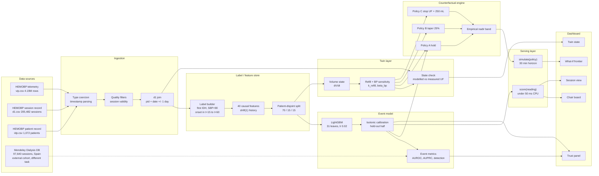

# HemoTwin Architecture

One page. Everything here maps to code in `src/`, artifacts in `artifacts/`, and the view in `app/streamlit_app.py`.

**Scope.** A per-reading event model and a per-session physiological twin, served locally to a Streamlit console. CPU only. No cloud dependency. No GPU.

---

## 1. Pipeline



### Plain ASCII

```
+-------------+   +-------------+   +----------------+   +-------------+   +--------------+
| DATA        |   | INGESTION   |   | LABEL/FEATURE  |   | EVENT MODEL |   | TWIN LAYER   |
|             |   |             |   | STORE          |   |             |   |              |
| vip.csv     |-->| coerce      |-->| first-event    |-->| LightGBM    |-->| volume state |
| d1.csv      |   | types       |   | label          |   | 40 features |   | dV/dt        |
| idp.csv     |   | filter      |   |                |   |             |   |              |
| Mendeley    |   | d1 join     |   | 40 features    |   | isotonic    |   | k_refill     |
| (external)  |   | +/-1 day    |   | shift(1)       |   | calibration |   | beta_bp      |
+-------------+   +-------------+   |                |   |             |   |              |
                                    | patient split  |   | AUROC 0.916 |   | state check  |
                                    | 70/15/15       |   +------+------+   +------+-------+
                                    +--------+-------+          |                 |
                                             |                  |                 |
                                             v                  v                 v
                                    +-----------------------------------------------------+
                                    | COUNTERFACTUAL ENGINE                               |
                                    | A hold  |  B taper 25%  |  C stop UF + 250 mL      |
                                    | + 90% band from held-out residuals                  |
                                    +--------------------------+--------------------------+
                                                               |
                                                               v
                                    +-----------------------------------------------------+
                                    | SERVING LAYER   score(reading) <50 ms   simulate()  |
                                    +--------------------------+--------------------------+
                                                               |
                                                               v
                                    +-----------------------------------------------------+
                                    | DASHBOARD (Streamlit)                               |
                                    | chairs | session | twin state | what-if | trust     |
                                    +-----------------------------------------------------+
```

---

## 2. Stage contracts

| Stage | Module | Input | Output | Contract |
|---|---|---|---|---|
| **Ingestion** | `src/data.py` | `data/raw/vip.csv`, `d1.csv`, `idp.csv` | typed frames, session index | Row counts must match FACTS (4,190,926 telemetry rows, 205,482 sessions) or the run aborts |
| **d1 join** | `src/data.py` | session index + `d1.csv` | per-session UF goal, measured weight loss, dialysate temperature | Match on `pid` + `date` ±1 day; unmatched sessions fall back to patient-median dry weight and are flagged |
| **Label builder** | `src/labels.py` | BP series + session index | anchor table, 1,268,990 anchors, 32,221 positives | First event only. Onset window `(t+15, t+60]`. Imminent-onset anchors dropped. Missing-window anchors dropped |
| **Feature store** | `src/features.py` | anchor table + telemetry + statics | 40-column matrix | Causal history only (`shift(1)`). No feature may read forward in time |
| **Split** | `src/labels.py` | anchor table | train / val / test | Patient-disjoint 70/15/15, asserted in code |
| **Event model** | `src/model.py` | feature matrix | calibrated probability per anchor | LightGBM + isotonic on held-out half of validation |
| **Twin** | `src/twin.py` | per-session UF and BP, patient history | `k_refill`, `beta_bp`, state trajectory | Population prior + patient-level fit; modelled volume is checked against measured UF and the median difference is reported in the train report |
| **Counterfactual** | `src/twin.py` | twin state + candidate policy | nadir, time-to-nadir, litres left behind, band | Monotone in UF: less removal never yields a lower nadir |
| **Serving** | `app/streamlit_app.py` | one BP reading + session context | score and optional policy simulation | Stateless per call, under 50 ms CPU |
| **Dashboard** | `app/streamlit_app.py` | frozen bundle | five views | No network. Never shows a point estimate without an interval |

---

## 3. Artifacts

The pipeline holds intermediate frames in memory and persists only what the dashboard and the audit trail need. That keeps the pipeline inside laptop RAM and keeps the committed repository small.

| Artifact | Produced by | Consumed by | Path |
|---|---|---|---|
| Trained booster (text model) | `src/model.py` `save()` | serving, demo bundle | `artifacts/hemotwin_event_model.txt` |
| Isotonic knots (JSON) | `src/model.py` `save()` | calibration portability, serving | `artifacts/hemotwin_isotonic.json` |
| Model metadata (JSON): feature list, best iteration, calibration summary, test metrics | `src/model.py` `save()` | training report, dashboard | `artifacts/hemotwin_meta.json` |
| Train report (JSON): event-level detection, session PPV, rule baselines, twin population, band, volume check, runtime | `scripts/train.py` | README, model card, trust panel | `artifacts/train_report.json` |
| Threshold sweep (JSON): operating-point trade-off, decision curve, trivial-policy baselines | `scripts/threshold_sweep.py` | README, deck slide 12, trust panel | `artifacts/threshold_sweep.json` (also embedded in the demo bundle) |
| Frozen demo bundle (JSON): 8 sessions with trajectories, forecasts, what-if cards, drivers, metrics, threshold sweep | `scripts/train.py` | dashboard | `demo/demo_bundle.json` |
| Session store (in memory) | `src/data.py` `build_session_store()` | features, twin | not persisted |
| Anchor table and feature matrix (in memory) | `src/labels.py`, `src/features.py` | training, evaluation | not persisted |

`artifacts/` is git-ignored. `demo/demo_bundle.json` is committed so a judge can run the console without downloading 263 MB of telemetry.

---

## 4. Design decisions and why

| Decision | Why it was made | What it costs |
|---|---|---|
| **Patient-disjoint split (70/15/15)** | Session-level splits leak patient physiology and prior events into test, inflating AUROC. Most published IDH work splits by session. A new patient is the deployment case. | Fewer effective samples; wider confidence intervals. Accepted. |
| **First-event-only labels** | Recurrent events within a session are easy to predict from "it already happened", a zero-training baseline at AUROC 0.798. Counting them inflates the score without adding clinical value. | Fewer positives (32,221), so AUPRC is noisy and must be read as a lift, not a headline. |
| **Imminent-onset exclusion (15 min)** | A reading 8 minutes before a crash is neither a fair positive nor a fair negative: the physiology has already moved. Dropping these anchors keeps the label honest. | The task becomes harder and sensitivity drops. We report the cost. |
| **No fabricated negatives** | If a session has no BP reading inside the window, the anchor is dropped. Treating silence as "no event" teaches the model that missing data means safety. | Anchor count falls; the 281 undetectable sessions stay undetectable and are reported. |
| **Causal `shift(1)` history** | Every lagged feature is shifted at session level so no row sees its own future. Prevents the classic leakage that makes offline AUROC unreachable in production. | Loses same-reading context; some slope features are noisier. |
| **Isotonic on a held-out half** | Fitting and evaluating calibration on the same split produces near-zero ECE by construction. Half the validation set is spent on the calibrator, half on the calibration report. | Less data for threshold selection; calibration curve is noisier. |
| **Empirical band from held-out residuals** | A point nadir invites false precision at the bedside. The band is the empirical 5th–95th percentile of hold-policy residuals on held-out patients, so its width is honest about cuff cadence. | Coverage is marginal, not per patient, and holds only if held-out and live patients are exchangeable, which local recalibration must verify. |
| **`gamma` fixed at zero** | With roughly 30-minute NIBP sampling, a free time-trend term is collinear with `beta_bp`; the fit becomes arbitrary. Keeping two identifiable parameters is more defensible than three unidentifiable ones. | Any genuine time-driven drift (autonomic fatigue, food, drugs) is absorbed into the residual band rather than modelled. |
| **Two-parameter physiological twin, not a sequence model** | `k_refill` and `beta_bp` are names a nephrologist can audit and a nurse can sanity-check. An uninterpretable GRU would be harder to defend and slower to build. | Lower ceiling on fit quality; residual structure is absorbed by the empirical band rather than the model. |
| **One horizon everywhere (15–60 min)** | Mixing a 15–60 min label with a 15–75 min evaluation reports two tasks as one result. One horizon means one claim. | Gives up the larger detection numbers a 75-minute window would produce. |
| **No external-validation claim** | The Spanish cohort has one pre and one post BP, so it cannot test a 15-60 minute event model. A reduced session-level model scored **0.720** internally and **0.474** in Spain because the labels mean different things (nadir SBP < 90 versus symptomatic hypotension). | We report the failed transport check and claim internal validity only. Deployment requires local retraining, not probability transplant. |
| **Policy space limited to UF** | 87.2% of sessions already taper UF; the counterfactual stays inside observed practice. Dialysate temperature has almost no variance (median 36.4 °C, p1–p99 35.8–37.0 °C), so a temperature lever would be extrapolation. | One lever. Depth comes from timing and magnitude, not from extra knobs. |
| **Offline frozen bundle for the demo** | Judges may clone without data access. A network dependency at demo time is a single point of failure. | Eight sessions, not the whole cohort. Clearly labelled. |

---

## 5. Latency and throughput

| Path | Work | Budget |
|---|---|---|
| `score(reading)` | 40-feature assembly + LightGBM traversal + isotonic lookup | **Under 50 ms on one CPU core**; no GPU, no batching required |
| `simulate(policy)` | 60-minute forward integration at 1-minute steps + band lookup | Under 50 ms; the model is two ODE terms and a linear BP link |
| Chair board refresh | 8 sessions x score + simulate | Under 1 s end to end, including Plotly payload |
| Full pipeline | 1,268,990 anchors, 40 features, twin fit | roughly 15–25 minutes on CPU, dominated by feature assembly and session I/O |

Inference is **per blood-pressure reading**, not per session. With a 30-minute cuff cadence and 8 chairs, the steady-state load is a handful of calls per minute: the deployment constraint is the network, not the model. No GPU is used anywhere in the pipeline.

---

## 6. Deployment shape (target, not built)

```
 dialysis machine (medical IoT)          edge box in unit              central console
 ─────────────────────────────           ────────────────              ───────────────
 BP, UF, dialysate  ──HL7/FHIR──>  local scorer (CPU)  ──HTTPS──>  remote nephrologist
                                          |                              |
                                     audit log + override         chair board + what-if
```

The prototype stops at "local scorer plus dashboard". A pilot would need HL7/FHIR ingestion, an audit log for every override, local recalibration on partner-machine data, and a prospective comparison against standard care. No claim of clinical benefit is made until that exists.

---

*Numbers in this document are governed by [`FACTS.md`](FACTS.md). Diagram source: [`architecture.svg`](architecture.svg).*
