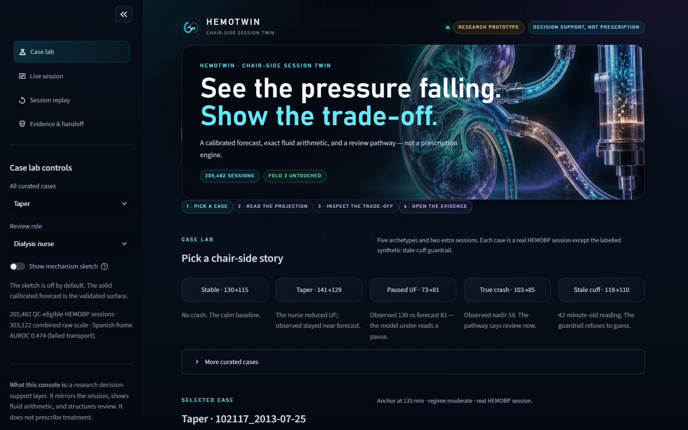
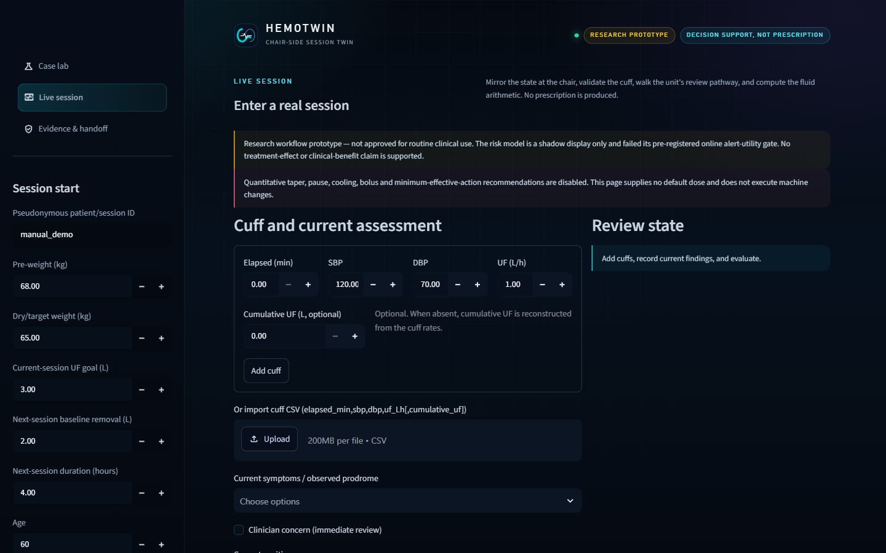
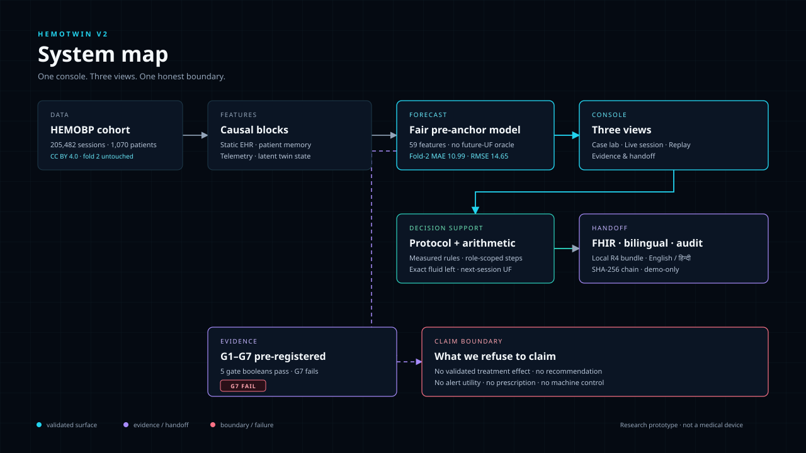

# HemoTwin V2

**A chair-side session twin for dialysis.** A calibrated pre-anchor forecast, exact
fluid arithmetic, and a role-scoped review pathway — for the technician at the
chair, not a prescription engine.

> **Status: research prototype. Not a medical device. No treatment-effect or
> clinical-benefit claim.** Five of six pre-registered checks pass; **the twin
> test fails**, and the what-if twin remains a labelled mechanism
> illustration. Fold 2 was never touched by tuning.



---

## Why this exists

We build a remotely operable, IoT-enabled haemodialysis machine. In the units it
serves, the doctor is often remote while a technician or dialysis specialist is at
the chair. IDH is one of the most common and risky events of a session, and the
person at the chair often has to act before a doctor can be reached.

The gap is not another score. It is **time** and a **shared trade-off**. HemoTwin
mirrors the session, structures the unit's review pathway, and makes the fluid
arithmetic explicit so the team can react and seek advice earlier.

**The product:** one console, four views — Case lab, Live session, Session
replay, and Evidence & handoff.

### What “G1–G7” means (plain language)

G1–G7 are seven checks we wrote down **before** looking at the results. They are
not a score and you do not need them to use the console. The one that matters
most is **G7, the twin test**:

> If UF is reduced early, does SBP recover more than in similar moments where it
> was not? **No.** The effect is +0.13 mmHg per 0.25 L/h, and the uncertainty
> interval includes zero. That is why the mechanism sketch is off by default.

The rest check the forecast and the policy model:

| Check | Plain-language question |
|---|---|
| G1 | Is the new pre-anchor forecast better than the retired v3 twin? |
| G2 | Is it honest against its own baseline, and how does it compare with an oracle-assisted display? |
| G3 | Does the twin predict an actual effect, or is it identical to simply holding UF? |
| G4 | Does the policy model behave consistently and continuously? |
| G5 | Do the 90% uncertainty bands cover reality? |
| G6 | Does it stay bounded for new patients and ignore future data? |
| G7 | **The twin test:** does reducing UF early actually raise SBP? |

The practical takeaway is simple: **the calibrated forecast and the fluid
arithmetic are the validated surfaces; the what-if twin is not.**

---

## The evidence at a glance

| What | Result |
|---|---|
| Cohort | **205,482** QC-eligible HEMOBP sessions · **1,070** patients · **4,190,926** telemetry rows · CC BY 4.0 |
| Combined raw scale | **303,122** sessions across the Taiwan + Spanish frames |
| External transport | Spanish external frame **AUROC 0.474** — transport failed; label semantics differ |
| Fair pre-anchor forecast | **Fold-2 MAE 10.99 mmHg** · RMSE 14.65 · 59 features · no future-UF oracle |
| Oracle display forecast | Fold-2 MAE 9.60 · 72 features incl. 13 observed future-UF features · display-only, **not** the G2 baseline |
| Checks G1–G6 | G1 pass · G2 pass vs its own base / fail vs the oracle · G3 **fail** · G4 pass · G5 pass (89.2% HOLD / 90.1% TAPER) · G6 pass |
| Twin test (G7) | **581** matched events / **158** patients · τ30 **+0.13 mmHg per 0.25 L/h** · 95% CI **[−2.63, +3.06]** · sham control +2.91 · P6a +0.43 · **verdict FAIL** |
| Event model | AUROC 0.880 ranking, but 8.2% detection at the 0.26 false-alert budget — below the current-SBP rule; **shadow only** |
| Twin-test census | 205,113 sessions; 369 of the 205,482 QC-eligible sessions lack the required pre-anchor record |

Two labels are reported separately and never combined: **10.4%** of HEMOBP
sessions have a labelled nadir below 90 mmHg; **25.5%** of the Spanish cohort has
a clinician-defined symptomatic label. They mean different things.

### The forecasts are not interchangeable

The console uses the **fair 59-feature pre-anchor model (10.99)**. The **9.60**
number is an oracle-assisted display forecast that consumes 13 observed future-UF
features; it is shown on the display-only card and is **not** the G2 baseline.
Comparing 9.60 to 10.99 as if they were the same model is wrong.

### What the twin test (G7) asked

A pre-registered, non-reactive UF step-down experiment with matched
within-patient controls, a continuous dose-response, a pre-anchor rule, and a
sham-time negative control. The estimated effect is indistinguishable from zero;
the sham control fails; P6a gets worse out of sample. The operational gain stays
**0**. The dashed mechanism sketch remains off by default.

---

## What is in the console

| View | What it does |
|---|---|
| **Case lab** | Seven curated chair-side stories: stable hold, taper, paused UF, true crash, stale cuff, mixed, and a taper showcase. Calibrated fan chart, observed ground truth, per-cuff click inspection (SBP/DBP/UF + twin state), fluid arithmetic, protocol state, 4-block causal state vector, and TreeSHAP attribution. |
| **Live session** | Enter a real session and cuffs (or import CSV). Validation, stale-cuff guardrail, deterministic protocol state, arithmetic fluid scenario, display-only forecast, and local audit append. |
| **Evidence & handoff** | checks scoreboard, twin-test forest plot, mechanism checks, temporal-order diagnostic, frozen protocol hash, claim boundary, FHIR R4 bundle, bilingual English/हिन्दी handoff card, SHA-256 audit chain, and 12-chair pod triage. |

The app has **no authentication, no role enforcement, no machine integration, no
external notification, and no network call at runtime**. The audit chain is a
local demo object, not an immutable clinical record.

The fan chart's shaded band is the **90% nadir interval, widened along the path
for display**; it is not a per-minute confidence band. The G7 forest plot and the
cohort funnel are generated from the frozen `evidence/g7_report.json`; the fan
chart is generated from the frozen `evidence/demo_twin.json`; the click inspector
reads `evidence/case_inspection.json`, which stores the recorded DBP/UF and the
twin state integrated from the same session. The UI calls the
point forecast **calibrated +60 min** rather than "nadir", because in some
sessions the forecast is above the anchor. For a stale cuff, the projection and
fluid arithmetic are withheld.



---

## Run it

No raw data and no lab artifacts are needed: the package ships the frozen evidence
and the small model bundles.

```bash
pip install -r requirements.txt
streamlit run app/hemotwin.py
```

Validated with Python 3.14 and the versions in `requirements.txt`
(Streamlit 1.66.1, Plotly 6.8.0, pandas 3.0.2, LightGBM 4.6.0).

### Tests and checks

```bash
python -m unittest discover -s tests -t .     # 228 tests, 0 failures
python scripts/verify_claim_boundary.py       # frozen gates + claim boundary
python scripts/verify_package.py              # assets, links, deck, package size
```

The lean app package skips 28 heavy lab-artifact tests. With the full portable
data/artifact pack beside `v2/`, 22 of those run and pass; 6 remain skip-gated
because their optional derived playback artifacts are not included. The full lab
suite in the research workspace is 241 tests.

### Three-minute demo

1. **Case lab** → pick *Taper (G1)* or *True crash*. Hover a cuff for the
   calibrated and observed SBP; click it for SBP, DBP, UF, and the twin state at
   that minute.
2. **Fluid arithmetic** → the calibrated +60 min projection is shared by every
   policy; the table shows what changes in the UF schedule and fluid carried
   forward.
3. **Protocol** → switch to *True crash*: observed nadir 59, state **REVIEW NOW**.
4. **Evidence & handoff** → open the twin test (G7), the claim boundary, the FHIR bundle, the audit
   chain, and the 12-chair pod.
5. **Session replay** → watch the forecast, then the recorded cuffs and UF steps
   roll forward; click a cuff or try a what-if card.
6. **Live session** → load the example cuffs and evaluate; the forecast is
   `manual_limited` and the state is computed only from measured rules.

---

## The boundary

**We can claim:** a calibrated pre-anchor nadir forecast; exact fluid arithmetic;
a deterministic, versioned review pathway; honest negative results from the twin tests
and the oracle baseline comparison; a local FHIR export and a hash-chained demo audit.

**We refuse to claim:** a validated what-if/treatment effect from the
twin; that any UF policy will raise SBP, prevent IDH, or is minimum effective;
alert utility, clinical benefit, or a safety layer; prospective, external,
symptomatic-IDH, or Indian-unit validation; a prescription, a default dose, or
autonomous machine action.

The boundary is part of the product. It is why the rest is trustworthy.

---

## Package map

```
v2/
├── app/                 one Streamlit app: shell + four views
│   ├── hemotwin.py      entrypoint and navigation
│   ├── manual_app.py    Live session body
│   ├── ui/              theme, charts, shell
│   └── views/           Case lab, Session replay, Evidence & handoff
├── assets/              brand/3D art + replay/replay.html
├── src/                 forecast serving, protocol engine, fluid arithmetic,
│                        v4 twin, G7 identification, FHIR, audit
├── models/              bundled model weights (no raw data)
├── evidence/            frozen reports, G7 protocol + hash, demo + per-cuff JSON, figures
├── demo/                curated playback bundle + audit files
├── config/              versioned research protocol
├── tests/               package test suite
├── scripts/             verifiers, deck/asset builders, lab provenance tools
├── report/              HemoTwin_Project_Overview.pdf + source HTML
├── deck/                HemoTwin_v2.pptx / HemoTwin_v2.pdf + assets
└── docs/                architecture, evidence status, facts, model card, QA,
                         design notes, deck notes
```



---

## Deck

- [HemoTwin_v2.pptx](deck/HemoTwin_v2.pptx) — 16 slides, 16:9, editable
- [HemoTwin_v2.pdf](deck/HemoTwin_v2.pdf) — judge-ready export
- [Project overview PDF](report/HemoTwin_Project_Overview.pdf) — 10-page overview: clinical gap, evidence, G7, system, app map, Q&A
- [Deck notes and Q&A](docs/DECK_NOTES.md)

The deck is story-first: the field reality, why prediction alone fails, the
console, the two forecasts, the trade-off, the protocol, the failed twin
experiment, the claim boundary, the evidence stack, and the pilot ask.

## Documentation

- [Evidence status and claim boundary](docs/EVIDENCE_STATUS.md)
- [Facts and copy source](docs/FACTS.md)
- [Model card](docs/MODEL_CARD.md)
- [Judge Q&A](docs/QA.md)
- [Design notes](docs/DESIGN.md)
- [Architecture](docs/ARCHITECTURE.md)
- [Deck notes](docs/DECK_NOTES.md)

To rebuild the deck or the dark chart assets, use `requirements-dev.txt` (adds
matplotlib, Pillow, python-pptx and, on Windows, pywin32 for the PDF export).

---

## Data and licence

HEMOBP (Lin et al., *Sci Data* 2019) is de-identified and released under
**CC BY 4.0**. Raw data is not committed. The repository contains derived
evidence, model weights, and curated demo sessions only. The app makes no
network call at runtime.

No Indian cohort has been collected or evaluated. Deployment in India would
require retraining on partner-machine data and local recalibration.

---

## Background

Built by an engineer working on a remotely operable, IoT-enabled haemodialysis
machine. The design target is the chair-side technician, not the nephrologist.
The product is a decision-support layer: it should buy enough time to react and
seek advice, not replace the clinician.

**Research prototype. Not a medical device. No treatment recommendation.**
