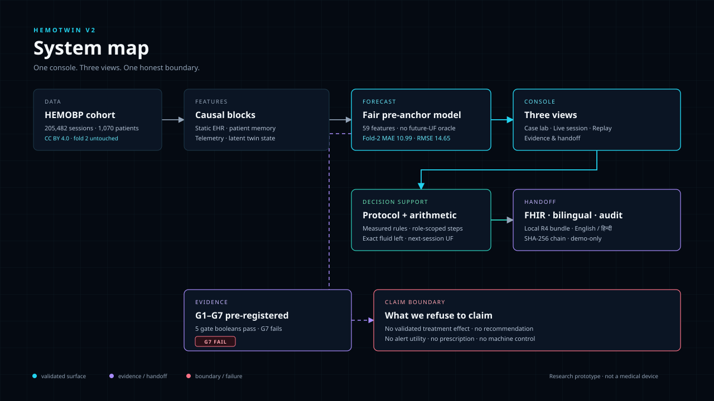

# HemoTwin V2 — architecture

## Flow

1. **Data.** HEMOBP (Taiwan) is the retrospective substrate: 205,482 QC-eligible
   sessions, 1,070 patients, CC BY 4.0. Raw data is not shipped in V2; the package
   carries derived evidence and the curated demo sessions.
2. **Causal feature blocks.** Static EHR facts, patient-history memory, telemetry
   and the latent Starling/baroreflex state are built strictly at or before the
   anchor. The 59-feature fair model does **not** consume future UF. The 72-feature
   Forecast-v2 display model does, and is labelled as oracle-assisted.
3. **Calibrated forecast.** The fair pre-anchor model produces the calibrated
   nadir mean and the 90% conformal band. Fold-2 MAE is 10.99; coverage is
   89.2% HOLD / 90.1% TAPER.
4. **Console.** One Streamlit entrypoint with four views:
   - **Case lab** — curated archetypes, fan chart with per-cuff click
     inspection, fluid arithmetic, protocol state, 4-block state vector, TreeSHAP.
   - **Live session** — manual/CSV entry, validation, stale-cuff guardrail,
     protocol state, fluid arithmetic, display-only forecast, local audit.
   - **Session replay** — curated retrospective replay inside the app shell;
     progressive forecast/observed readings, clickable cuffs and UF steps.
   - **Evidence & handoff** — gates, G7, lineage, claim boundary, FHIR, bilingual
     handoff, audit chain, pod triage.
5. **Decision support.** The protocol engine is deterministic and versioned. The
   forecast never gates the state. The shadow risk score is display-only and has
   no alert authority. The fluid arithmetic is not a prescription.
6. **Handoff.** FHIR R4 bundle, English/हिन्दी shift card, local SHA-256 audit
   chain, 12-chair workflow sort. The audit is demo-only and says so.
7. **Evidence.** G1–G7 are pre-registered. Five of six gate booleans pass; G3 and
   G7 fail. The claim boundary is a first-class output, not a footnote.

## Package boundaries

| Layer | Responsibility | Does not |
|---|---|---|
| `app/` | Shell, theme, four views | Train models or call the network |
| `src/` | Forecast serving, protocol, fluid arithmetic, v4/G7, FHIR, audit | Make clinical recommendations |
| `models/` | Small frozen bundles (v4, Forecast-v2, event model) | Contain raw data |
| `evidence/` | Frozen reports, G7 protocol/hash, demo JSON, figures | Change after estimation |
| `scripts/` | Verifiers, deck/asset builders, lab provenance | Run in the app runtime |
| `tests/` | Package test suite with explicit lab-artifact skips | Hide missing heavy artifacts |

## Security and claim boundary

The prototype has no authentication, no role enforcement, no machine integration,
no external notification, and no network call at runtime. The role selector is a
recorded label. The audit chain is local and not immutable. The app does not
prescribe, does not execute machine changes, and does not claim a treatment
effect. The G7 experiment failed and the mechanism fan is off by default.

For the authoritative claim boundary, see
[`EVIDENCE_STATUS.md`](EVIDENCE_STATUS.md).
